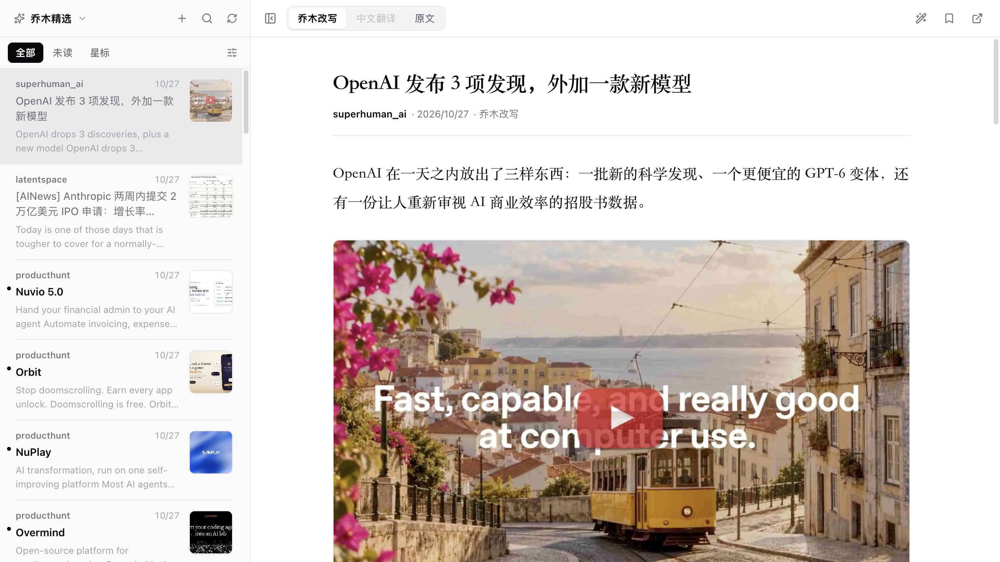

# 乔木 RSS · qmreader-floatboat

**中文** · [English](#english)

在 [Floatboat](https://floatboat.ai) 里阅读[乔木 RSS](https://rss.qiaomu.ai)：精选频道、乔木改写、中文翻译和原文一屏切换，带着正在读的文章去问 Floatboat 自带的 AI。



## 能做什么

| 功能 | 说明 |
| --- | --- |
| 线上频道 | 直接读取 `rss.qiaomu.ai` 的公开 API，按聚合、微信公众号、播客、Newsletter、博客与资讯、读者社区分组 |
| 三种版本 | 乔木改写、中文翻译、原文。没有的版本标灰，不会自动调用 AI 生成 |
| 无限滚动 | 文章列表滚到底自动加载下一页 |
| 个人订阅 | 添加任意 RSS / Atom 地址，在本机读取，不需要乔木账号 |
| AI 伴读 | 选中一段文字点「剖析此段」，或点工具栏的伴读按钮，复制带文章上下文的提问，粘贴到 Floatboat 对话 |
| 阅读外观 | 字体、字号、行距、版心宽度和 7 种阅读主题，设置保存在本机 |

已读、星标和个人订阅保存在工作台自己的 SQLite 里，不会写回线上。

## 安装

需要 Floatboat 桌面端。工作台运行时（`sdk/`）由 Floatboat 在本机提供，不在本仓库中。

1. 在 Floatboat 新建一个工作空间，让 Agent 为它创建工作台。
2. 把本仓库除 `sdk/` 以外的文件复制到工作台源码目录（Agent 会告诉你路径，形如 `~/.floatboat/<workspaceId>/workbench/`）。
3. 让 Agent 检查并打开工作台。

`manifest.json` 里的 `appId` 是作者本机的登记号，新建工作台时 Floatboat 会分配你自己的，复制时保留你目录里原有的那一行即可。

## 开发

需要 Node.js 22.16 以上。

```bash
npm test
```

测试覆盖 Markdown 渲染（嵌套方括号图片、链接、XSS 与 `javascript:` 拦截）、分页边界和频道分组。模块职责和本地 API 见 [ENGINEERING.md](ENGINEERING.md)，视觉规则见 [DESIGN.md](DESIGN.md)。

## 数据与来源

- 文章、改写和翻译来自 [乔木 RSS](https://rss.qiaomu.ai) 的公开接口，本项目只读取，不改动服务端数据。
- 频道分组规则移植自 [乔木 AI RSS（Obsidian 插件）](https://github.com/joeseesun/qiaomu-ai-rss)，选区锚定和伴读提问格式参考 [qiaomu-rss-dsh](https://github.com/joeseesun/qiaomu-rss-dsh)。两者均为 GPL-3.0-only。
- AI 伴读使用 Floatboat 自带的模型和对话，模型配置与费用由 Floatboat 管理。

## 许可证

[GPL-3.0-only](LICENSE)。

---

## English

Read [Qiaomu RSS](https://rss.qiaomu.ai) inside [Floatboat](https://floatboat.ai): curated channels, Qiaomu rewrites, Chinese translations and originals on one screen, plus a one-click handoff of the current article to Floatboat's built-in AI chat.

**Features**

- Online channels from the public `rss.qiaomu.ai` API, grouped into aggregates, WeChat accounts, podcasts, newsletters, blogs and community picks.
- Rewrite / translation / original versions. Missing versions are greyed out; nothing is generated automatically.
- Infinite scroll in the article list.
- Personal RSS / Atom subscriptions, fetched locally without a Qiaomu account.
- Select a passage and click "剖析此段", or use the toolbar button, to copy a context-rich prompt for Floatboat's chat.
- Reading appearance: font, size, line height, measure and seven themes.

Read state, stars and personal subscriptions live in the workbench's own SQLite and are never written back to the server.

**Install**: requires Floatboat desktop. The workbench runtime (`sdk/`) is provided by Floatboat and is not included here. Create a workbench in a new workspace, copy everything except `sdk/` into its source directory, keep your own `appId` in `manifest.json`, then ask the agent to check and open it.

**Develop**: Node.js 22.16+, run `npm test`.

**License**: [GPL-3.0-only](LICENSE). Channel grouping is ported from the GPL-3.0-only Obsidian plugin, and selection anchoring follows qiaomu-rss-dsh.
